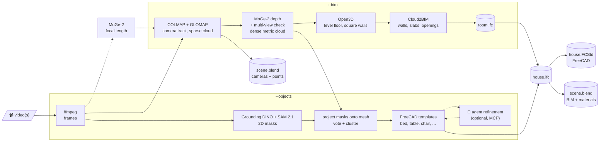
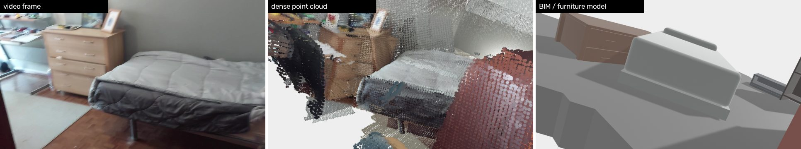
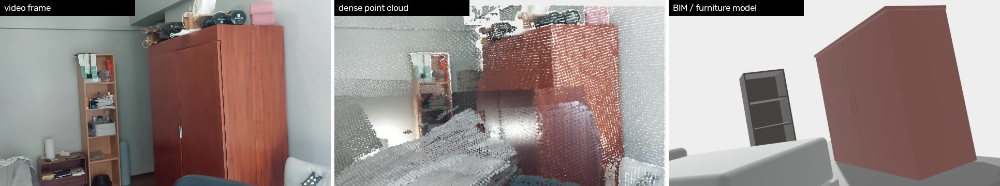
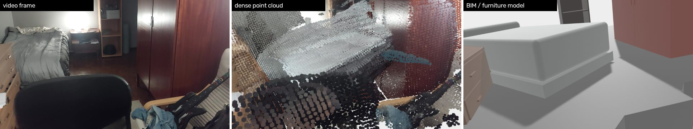

# vid2bim

vid2bim turns phone videos of a house into a **BIM model, in FreeCAD and Blender**. You get the walls and slabs, plus the furniture it recognizes, each modelled, coloured and placed at its measured position. Everything is built from open-source tools.



> [!NOTE]
> vid2bim started as a Unix port of [polyfjord's `batch_reconstruct.bat`](https://gist.github.com/polyfjord/4ed7e8988bdb9674145f1c270440200d) workflow, built on [COLMAP](https://colmap.github.io/) (through `pycolmap`) and ffmpeg. Without `--bim`, it still does exactly that: it produces a `.blend` with the point cloud and camera track, and no add-on is needed. The COLMAP model it exports also works with [SBCV's Photogrammetry Importer](https://github.com/SBCV/Blender-Addon-Photogrammetry-Importer).

> [!WARNING]
> The BIM and furniture steps are **experimental**. The result depends heavily on how the video was filmed; see [Filming tips](#filming-tips).

## Example: video vs. reconstruction

These are three frames from two handheld phone clips of one bedroom. Each row shows the original video frame on the left, then the fused dense point cloud and the BIM/furniture model, both rendered in Blender from **the same solved camera at the same frame**.





In this scene, vid2bim:
- detected 10 furniture objects;
- had the agent refinement step merge duplicates and fix labels, leaving 7: a bed, a chest of drawers, a wardrobe, a bookshelf, a nightstand, an office chair and a lounge chair;
- modelled each one in FreeCAD and placed it in `house.ifc`.

> [!NOTE]
> These clips are mostly turning in place, which is the hardest case. The point cloud has "floaters" where frames disagree. Some objects are only partly scanned, so their models are approximate in size and position. A slow walk along the walls gives much cleaner results.

## Setup

You need `ffmpeg`, Python ≥ 3.10 and Blender ≥ 4.0 on your `PATH`. For the BIM steps you also need FreeCAD 1.x (the Flatpak works). An NVIDIA GPU is strongly recommended; the scripts were developed on a 6 GB RTX 2060.

```bash
./setup.sh            # .venv with COLMAP (pycolmap, CUDA build if a GPU is found)
./setup.sh --bim      # + PyTorch, MoGe-2, Open3D, IfcOpenShell, Cloud2BIM (about 4 GB)
```

> [!NOTE]
> The models are downloaded from Hugging Face the first time they are used:
> - MoGe-2, about 1.3 GB
> - Grounding DINO, about 0.9 GB
> - SAM 2.1, about 0.3 GB

## Usage

```bash
./vid2bim clip.mp4                              # camera track + point cloud -> scenes/clip/clip.blend
./vid2bim clip.mp4 --fps 10 --bim               # + room BIM (IFC, FreeCAD, Blender)
./vid2bim clip.mp4 --fps 10 --objects           # + furniture modelled and placed in the house
./vid2bim videos/ --fps 10 --objects            # folder mode, see below
./vid2bim street.mp4 --fps 10 --max-depth 25 --objects \
         --classes "car,van,truck,bus,motorcycle,bicycle"   # outdoors, see below
```

### Folder mode

`./vid2bim videos/` groups the videos by where they are:

```
videos/
├── home/              # sub-folder = one space: all its videos are MERGED -> scenes/home/
│   ├── clip.mp4
│   └── clip_1.mp4
└── garden.mp4         # loose video = isolated scene                  -> scenes/garden/
```

> [!TIP]
> Put every video of the same house in one sub-folder. Keyframes of each video are matched against all the others, so the clips end up in one shared model. Overlapping views, such as the same doorway filmed in two clips, make this much more reliable.

### Options

Run `./vid2bim -h` for the full list.

| option | meaning |
|---|---|
| `--fps N` | Frames per second to extract. The default is every frame. **10** is a good choice for walkthroughs. |
| `--frame-select sharp\|uniform` | With `--fps`, keep the **sharpest** frame of each interval (the default) or evenly spaced frames. |
| `--bim` | Build the room BIM: dense cloud → IFC → FreeCAD → Blender. |
| `--objects` | Also detect, model and place furniture. Implies `--bim`. |
| `--classes "bed,desk,…"` | Which objects to look for (open vocabulary). |
| `--hfov DEG` | Your camera's horizontal field of view. It is estimated with MoGe-2 by default. |
| `--ceiling-height M` | Indoors only: ceiling height to use when the video never shows the ceiling. The default is 2.6. |
| `--scene-type auto\|indoor\|outdoor` | Room BIM (Cloud2BIM) or [outdoor mode](#outdoor-scenes). `auto` decides from the scan. |
| `--max-depth M` | Ignore depth beyond this many metres in the dense cloud. The default is 6, which suits rooms; use **25** outdoors. |
| `--merge NAME` | Force all inputs into one scene. |
| `--mapper global\|incremental` | COLMAP's global mapper (GLOMAP, the default) or the classic incremental mapper. |
| `--overlap N` | How many neighbouring frames each frame is matched with. The default is 15. |
| `--rebuild-blend` | Only regenerate the `.blend` (and with `--bim`, the BIM) of existing scenes. |
| `--force` | Redo scenes that already exist. Existing scenes are skipped by default. |

> [!IMPORTANT]
> Phone videos don't store the lens' focal length. A wrong focal length bends the whole room. vid2bim estimates it with MoGe-2 and keeps it fixed. If you know your phone's main-camera field of view, pass `--hfov`.

## How it works

| step | tool (all open source) | output in `scenes/<name>/` |
|---|---|---|
| Camera poses | COLMAP + GLOMAP global mapper, with frames that have no 3D points removed | `model_txt/`, `<name>.blend` |
| Dense, metric cloud | [MoGe-2](https://github.com/microsoft/MoGe) (MIT): one depth map per frame, scaled to the COLMAP points, smoothed over time, and kept only where neighbouring frames agree | `dense.ply`, `dense_mesh.ply` |
| Level and square the room | [Open3D](https://www.open3d.org/) (MIT): the floor below the cameras, then the dominant wall direction | `bim/aligned.ply`, `bim/align.json` |
| Point cloud → IFC4 | [Cloud2BIM](https://github.com/VaclavNezerka/Cloud2BIM) (MIT): slabs, walls, door/window openings, spaces | `bim/room.ifc`, `bim/room.FCStd` |
| Find furniture | [Grounding DINO](https://huggingface.co/IDEA-Research/grounding-dino-base) + [SAM 2.1](https://huggingface.co/facebook/sam2.1-hiera-base-plus) (Apache-2.0) on the frames, with the masks projected onto the mesh, voted on, then clustered | `objects/objects.json`, `<id>.ply`, `<id>.jpg` |
| Model furniture | Parametric FreeCAD templates (bed, table, chair, shelf, cabinet, sofa…), sized and placed from the measurements | `objects/furniture.FCStd` |
| Into the house | IfcOpenShell (LGPL) adds `IfcFurniture` with the measured colour and material | `bim/house.ifc`, `bim/house.FCStd` |
| Blender | Meshes from IfcOpenShell; each furniture item gets its measured colour and a wood, fabric or plastic material | `<name>.blend` (`BIM` collection and `DenseCloud`) |

Everything is in **metres, z-up, with the floor at z = 0**, in both FreeCAD and Blender.

The `.blend` contains:
- **`COLMAP`** is an empty that holds the sparse `PointCloud`, the animated cameras `Cam_<video>` and their paths `Track_<video>`. With `--bim` it is already transformed into the metric BIM frame.
- **`DenseCloud`** is the fused dense cloud. It is hidden in renders.
- **`BIM`** is a collection with the walls, slabs and furniture.

> [!TIP]
> Select `Cam_<video>`, press *Numpad 0* and play the animation. The original frames are the camera background, so you can see straight away whether the model lines up with the video.

## Outdoor scenes

A room model makes no sense in a street: there is no ceiling, and the walls aren't around you. So for outdoor scans, vid2bim skips Cloud2BIM and only models what the scan really shows.

| element | rule | IFC |
|---|---|---|
| Ground | One slab following the ground area that was actually scanned (not a rectangle) | `IfcSlab` (BASESLAB) |
| Façade | A vertical surface becomes a wall only if it is at least **3 m long** and at least **2.5 m** of it is visible, at least **50 %** of it is covered by points, and it reaches the ground. Parked cars may hide up to 2.8 m of its bottom; the wall is then extended to the ground and noted in its description. | `IfcWall`, with its measured length and height, placed behind the visible face |
| Vehicles | Detected with `--classes "car,van,…"`, modelled as body, cabin and wheels in their measured colour, rotated along the street | `IfcBuildingElementProxy` (type `car`, `van`, …) |
| Ceiling, roof, invented walls | Never | none |

Every vertical surface that fails a rule is listed in `scenes/<name>/room_run.log` with the reason: too short, too low, floating, or sparse.

> [!NOTE]
> **Outdoor mode is chosen automatically** when the scan reaches higher than 4 m (taller than a room) or is wider than 20 m without a ceiling over it. Force it either way with `--scene-type outdoor` or `--scene-type indoor`.

> [!TIP]
> **Moving vehicles are ignored automatically.** A car that drives by never sits in the same place in 3D, so its detections never collect enough consistent votes on the scanned surface to form an object. Only parked vehicles are modelled.

> [!IMPORTANT]
> Use `--max-depth 25` outdoors. With the default of 6 m, which is meant for rooms, most of every car and façade is cut off. Very large clouds are thinned to 800,000 points inside the `.blend`; the full cloud is always in `dense.ply`.

Outdoor scans also tend to work better than indoor ones. Walking along a street gives COLMAP plenty of sideways movement, and façades, cars and pavement are full of texture. In our tests every frame was placed, and the dense depth agreed between frames to within ±1–3 %.

> [!CAUTION]
> Outdoor footage and its reconstruction show a real, recognisable place. `videos/` and `scenes/` are gitignored. Think twice before sharing street scans or screenshots of them.

## Refining furniture with an agent

The templates are a first draft. An agent can then look at each object's photo crop and points, and refine the FreeCAD model: which end the headboard is on, how many drawers there are, the leg style, wrong labels, duplicates. The instructions for the agent are in [`agent/refine_objects.md`](agent/refine_objects.md). With Claude Code:

```bash
claude -p "Follow agent/refine_objects.md for SCENE=scenes/home"
```

The agent finishes by running `furniture.py SCENE --from-fcstd`, which pushes the edited shapes into `house.ifc`, `house.FCStd` and the Blender meshes.

> [!NOTE]
> The agent step is optional and is the only part that isn't open source: Claude Code is a paid service. Any MCP-capable agent can follow the same instructions.

## AI agent access to Blender and FreeCAD (MCP)

`.mcp.json` registers two MCP servers for this project, so agents opened in this folder can drive the apps:

- `blender` is [MCP for Blender](https://github.com/ahujasid/mcp-for-blender), started with `uvx mcp-for-blender`. Its telemetry is turned off in `.mcp.json`.
- `freecad` is [freecad-mcp](https://github.com/neka-nat/freecad-mcp), started with `uvx freecad-mcp`.

Each server talks to an add-on that runs inside the app, so install the add-ons once:

```bash
# Blender add-on, then enable "Interface: MCP for Blender" in Preferences → Add-ons
mkdir -p ~/.config/blender/4.0/scripts/addons
DISABLE_TELEMETRY=true BLENDERMCP_ADDONS_DIR=~/.config/blender/4.0/scripts/addons uvx mcp-for-blender install-addon

# FreeCAD add-on (the folder below is for the Flatpak install of FreeCAD 1.1;
# in FreeCAD's Python console, os.path.join(FreeCAD.getUserAppDataDir(), "Mod") prints yours)
git clone --depth 1 https://github.com/neka-nat/freecad-mcp.git /tmp/freecad-mcp
mkdir -p ~/.var/app/org.freecad.FreeCAD/data/FreeCAD/v1-1/Mod
cp -r /tmp/freecad-mcp/addon/FreeCADMCP ~/.var/app/org.freecad.FreeCAD/data/FreeCAD/v1-1/Mod/
```

Each app has to be open for its agent tools to work:

- **Blender:** the add-on starts its server on `localhost:9876` automatically. You can also start it from the **MCP for Blender** tab in the 3D view's `N` panel.
- **FreeCAD:** switch to the **MCP Addon** workbench and click **Start RPC Server**, which listens on `127.0.0.1:9875`. Enable **FreeCAD MCP → Auto-Start Server** to have it start on its own.

> [!CAUTION]
> Both servers let an agent run **arbitrary Python** inside the app, without authentication. Keep them bound to localhost, and save your work before letting an agent edit a scene.

## Filming tips

> [!TIP]
> - **Walk, don't spin.** Move sideways along the walls. COLMAP needs parallax, and turning in place gives none.
> - **Go slowly through doorways and narrow hallways.** That's where tracking breaks.
> - **Tilt up to the ceiling now and then**, and down to the floor.
> - **Avoid long shots out of windows**, mirrors and plain white walls filling the whole frame.
> - **Keep people and pets out of the shot.** Only static scenes reconstruct well.
> - **Don't stabilize the video**, and turn off your phone's video stabilization (EIS) if you can. Stabilization warps and crops every frame differently, which breaks the single-lens camera model. In a test it cost 15% of the 3D points. Picking the sharpest frame from each interval (the default) helps instead: +5% points, +12% matches per frame and 7% lower reprojection error.

## Credits and related projects

vid2bim builds on other people's work. If it doesn't fit your needs, one of these might:

- **[polyfjord](https://gist.github.com/polyfjord/4ed7e8988bdb9674145f1c270440200d)** wrote the original Windows `batch_reconstruct.bat` and the tutorial video it comes from.
- **[COLMAP](https://colmap.github.io/)** / **[pycolmap](https://github.com/colmap/pycolmap)** handle the camera tracking, **[MoGe-2](https://github.com/microsoft/MoGe)** the dense depth, **[Cloud2BIM](https://github.com/VaclavNezerka/Cloud2BIM)** the point cloud → IFC conversion, **[Grounding DINO](https://github.com/IDEA-Research/GroundingDINO)** and **[SAM 2](https://github.com/facebookresearch/sam2)** the object detection, and **[IfcOpenShell](https://ifcopenshell.org/)** the IFC handling.
- **[SBCV's Photogrammetry Importer](https://github.com/SBCV/Blender-Addon-Photogrammetry-Importer)** is the Blender add-on the original workflow uses. The `model_txt/` output stays compatible with it.
- **[oneShot](https://github.com/beingcarrot/oneShot)** by beingcarrot is a Blender add-on that does video → COLMAP → Blender from inside Blender.
- Unix ports of polyfjord's script:
  - [Chaos-man's Linux guide and script](https://gist.github.com/Chaos-man/cbe063cbfb0624026f022a0ae8de021f) (GLOMAP)
  - [Norgus's bash version](https://gist.github.com/Norgus/9e877924949d778db12c534ff1bafe36), adapted from celestial-33's macOS port
  - [souhaib101's Polyfjord-COLMAP-Workflow](https://zff.dev/souhaib101/Polyfjord-COLMAP-Workflow) (POSIX shell)

## License

vid2bim is released under the [MIT License](LICENSE). It downloads and uses third-party tools and models under their own licences:
- COLMAP (BSD-3)
- MoGe-2, Cloud2BIM and Open3D (MIT)
- Grounding DINO and SAM 2.1 (Apache-2.0)
- IfcOpenShell (LGPL-3)
- FreeCAD (LGPL-2+)
- Blender (GPL)
